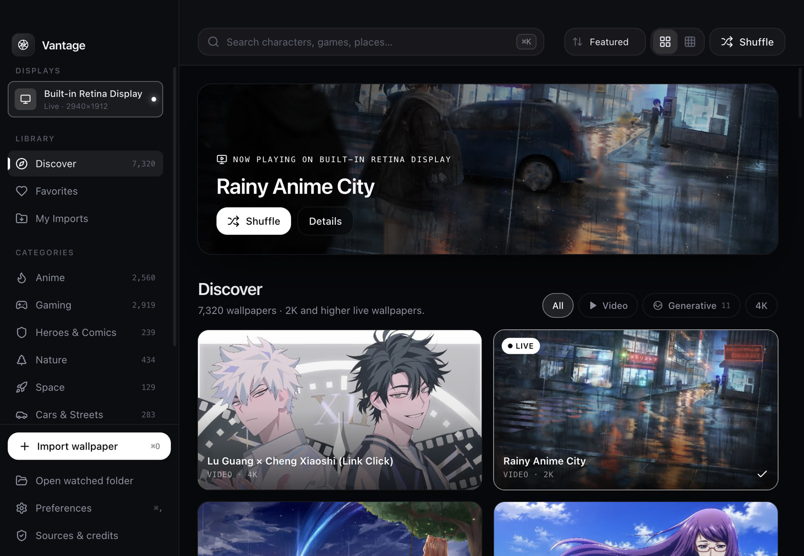
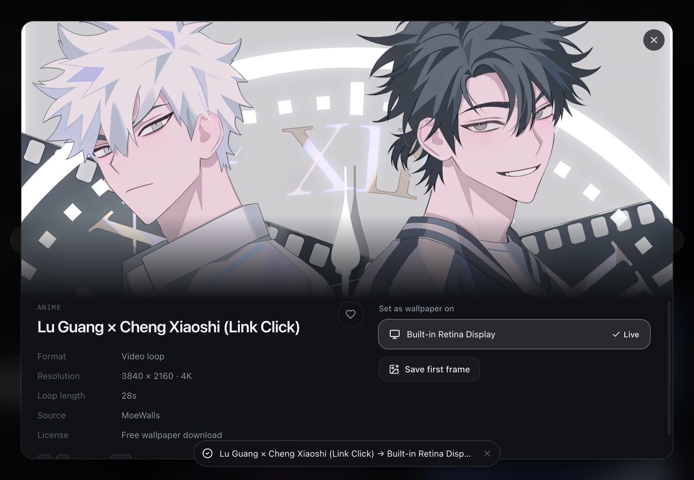
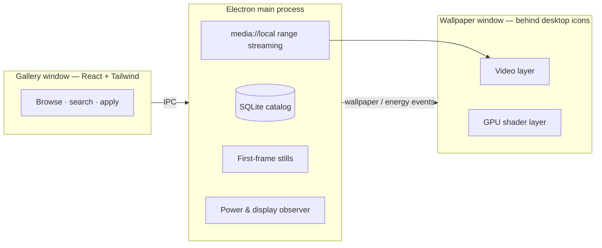

<a id="top"></a>

<div align="center">

<a href="https://vantage-wallpapers.vercel.app">
  
</a>

<h1>Vantage</h1>

<p><i>Your desktop, alive.</i></p>

<p>
  <b>Free, open-source live wallpapers for macOS and Windows.</b><br />
  7,300+ 2K &amp; 4K motion wallpapers, live GPU scenes, every display — without slowing your machine down.
</p>

<p>
  <a href="https://github.com/JayDev-27/Vantage/releases/latest"></a>
  <a href="https://github.com/JayDev-27/Vantage/releases"></a>
  
  <a href="https://github.com/JayDev-27/Vantage/actions/workflows/smoke.yml"></a>
  <a href="LICENSE"></a>
</p>

<p>
  <a href="https://vantage-wallpapers.vercel.app"><b>Website</b></a> ·
  <a href="https://github.com/JayDev-27/Vantage/releases/latest"><b>Download</b></a> ·
  <a href="#-whats-new-in-13">What's new</a> ·
  <a href="#-features">Features</a> ·
  <a href="#%EF%B8%8F-build-from-source">Build</a> ·
  <a href="#-contributors">Contributors</a>
</p>



</div>

---

## 📑 Contents

- [What's new in 1.3](#-whats-new-in-13)
- [Why Vantage](#-why-vantage)
- [Features](#-features)
- [Download & first launch](#-download--first-launch)
- [The website](#-the-website)
- [Build from source](#%EF%B8%8F-build-from-source)
- [How it works](#%EF%B8%8F-how-it-works)
- [Testing](#-testing)
- [Roadmap](#%EF%B8%8F-roadmap) · [Contributors](#-contributors) · [License](#-license)

## 🆕 What's new in 1.3

- **1.3.1:** live wallpapers start playing while they download, the wallpaper no longer leaves a white strip under the macOS menu bar, and the download badge moved to the top-left.
- **2K & 4K only:** the library now ships only wallpapers at least 1440 px on both edges — 7,300+ sharp wallpapers instead of 13,000 mixed ones.
- **New bundled wallpapers:** *Lu Guang × Cheng Xiaoshi (Link Click)* and *Raphtalia — The Rising of the Shield Hero*, in 4K, available offline.
- **Save first frame:** turn any 2K/4K video wallpaper into a full-quality still with one click; stills share a lightweight thumbnail and can be deleted and restored.
- **Faster, lighter library:** dimensions and thumbnails are read from the videos themselves instead of external tools, and catalog syncing is cached.
- Everything from 1.2: Windows desktop attach fix, macOS full-screen fix, MotionBGS library with categories from its own tags.

## ✨ Why Vantage

- 🖥️ **Every display, its own world** — a different wallpaper per monitor; hot-plug a screen and Vantage picks up where it left off.
- ⚡ **4K that sips power** — videos stream from disk with HTTP range requests, and Vantage drops to battery-saver cadence when you unplug.
- 🌌 **Generative scenes** — 8 GPU shader wallpapers render live and react to your cursor. Nothing to download, never loops.
- 📂 **Bring your own** — import MP4, MOV, WebM, PNG, JPG or WebP, or drop files into a watched folder.
- 🎛️ **Out of your way** — menu bar + Dock (hide the Dock icon any time), ⌘K search, Shuffle.
- 🔓 **Free & open source** — MIT licensed, no account, no tracking.

<div align="center">
  
</div>

## 📸 Features

<table>
  <tr>
    <td width="50%"></td>
    <td width="50%"></td>
  </tr>
  <tr>
    <td align="center"><b>Detail &amp; apply</b><br /><sub>4K preview, source and license, per-display Set, Save first frame. ← → to browse.</sub></td>
    <td align="center"><b>Generative canvases</b><br /><sub>Procedural scenes rendered on your GPU, previewed live in the grid.</sub></td>
  </tr>
  <tr>
    <td width="50%"></td>
    <td width="50%"></td>
  </tr>
  <tr>
    <td align="center"><b>On your actual desktop</b><br /><sub>Iris Bloom running live behind your icons.</sub></td>
    <td align="center"><b>Preferences</b><br /><sub>Energy mode per display, Dock &amp; login, cache control.</sub></td>
  </tr>
</table>

<details>
<summary><b>Everything Vantage does</b></summary>

| | |
|:--|:--|
| **Library** | 7,300+ 2K/4K wallpapers across Anime, Gaming, Heroes &amp; Comics, Nature, Space, Cars &amp; Streets, Digital Art and Generative, plus your own imports and stills |
| **Gallery** | Now Playing with Shuffle, display cards, category counts, ⌘K search, sort, two grid sizes, hover-to-preview, one-click **Set**, favorites |
| **Stills** | Save the first frame of any 2K/4K video as a full-quality still wallpaper |
| **Multi-monitor** | Independent wallpaper and energy mode per display, apply to all, hot-plug aware |
| **Energy** | Quality (60 fps), Balanced (30 fps), Battery (15 fps); shaders lower their render resolution too; automatic saver on battery |
| **Streaming** | `media://local/` protocol with HTTP 206 range requests; downloads cached on disk with a configurable limit |
| **Imports** | ⌘O, or drop files into `~/Pictures/Vantage Wallpapers/` (videos) and its `Static/` folder (images) |
| **macOS** | Behind your icons, never over full-screen apps; menu bar + Dock; native Screen Saver companion |
| **Windows** | Behind your desktop icons via WorkerW; tray menu; NSIS installer |

</details>

### 🌌 Generative wallpapers

| | | | |
|:--:|:--:|:--:|:--:|
| **Iris Bloom** | **Liquid Chrome** | **Silk Waves** | **Neon Horizon** |
| **Ink Nebula** | **Warp Drive** | **Aurora Veil** | **Lava Lamp** |

Plus **Quantum Field**, **Aurora Flow** and **Nebula Drift**. Rendered by GLSL shaders in [`src/renderer/shared/shaders.ts`](src/renderer/shared/shaders.ts).

## 📥 Download & first launch

| Platform | File | |
|:--|:--|:--|
| 🍏 macOS · Apple Silicon (M1–M5) | `Vantage-1.3.1-arm64.dmg` | [Latest release](https://github.com/JayDev-27/Vantage/releases/latest) |
| 🍏 macOS · Intel | `Vantage-1.3.1-x64.dmg` | [Latest release](https://github.com/JayDev-27/Vantage/releases/latest) |
| 🪟 Windows 10/11 · x64 | `Vantage-Setup-1.3.1-x64.exe` | [Latest release](https://github.com/JayDev-27/Vantage/releases/latest) |
| 🪟 Windows 11 · ARM | `Vantage-Setup-1.3.1-arm64.exe` | [Latest release](https://github.com/JayDev-27/Vantage/releases/latest) |

Or visit **[vantage-wallpapers.vercel.app](https://vantage-wallpapers.vercel.app)** — the download button picks the right file for your computer.

> [!NOTE]
> **Mac:** Vantage isn't notarized by Apple yet. If macOS says it can't verify the app, open **System Settings → Privacy & Security** and click **Open Anyway**.
>
> **Windows:** the installer isn't code-signed yet; on SmartScreen choose **More info → Run anyway**.

## 🌐 The website

The landing page in [`website/`](website/README.md) is a Three.js / WebGL scroll experience: a 3D monitor plays a wallpaper, the camera dives into the screen, a glass window of live wallpapers falls through a tunnel, and you land on the download.

<div align="center">
  <a href="https://vantage-wallpapers.vercel.app"></a>
</div>

## 🛠️ Build from source

**Requirements:** Node.js 20.19+ and npm. The macOS Screen Saver companion needs Xcode command-line tools.

```bash
git clone https://github.com/JayDev-27/Vantage.git
cd Vantage
npm install
npm run dev
```

<details>
<summary><b>All scripts</b></summary>

| Command | What it does |
|:--|:--|
| `npm run dev` | Run the app with hot reload |
| `npm run typecheck` | TypeScript check across main, preload and renderer |
| `npm run preview:ui` | Gallery UI in a browser with a mocked API (`http://localhost:5181/gallery.html`) |
| `npm run audit:catalog` | Check the catalog for category mistakes, duplicates and missing files |
| `node scripts/import-motionbgs.mjs` | Refresh the MotionBGS part of the catalog (`--write` to save) |
| `node scripts/smoke-test.mjs <app>` | Launch a built app as a fresh install and verify it (see [Testing](#-testing)) |
| `npm run dist:mac` / `npm run dist:win` | Build installers |
| `npm --prefix website run dev` | Run the website locally |

Pushing a `v*` tag runs [`release.yml`](.github/workflows/release.yml), which builds macOS and Windows installers into a draft release.

</details>

## 🏛️ How it works



**Stack:** Electron 43 · React 18 · TypeScript · Tailwind CSS · electron-vite · better-sqlite3 · koffi (Windows) · Three.js + Lenis (website)

## 🧪 Testing

Every pull request and release runs [`smoke.yml`](.github/workflows/smoke.yml): the app is built and launched as a **fresh install on clean macOS and Windows machines**, then checked over DevTools — gallery opens, catalog loads, tiles render, first-frame stills save and restore, every display gets a playing wallpaper, it sits behind the desktop icons on Windows, and the log has no fatal errors.

## 🗺️ Roadmap

- [x] Redesigned gallery, Shuffle, ⌘K search
- [x] GPU shader wallpapers
- [x] Windows support with desktop attach
- [x] Sandbox smoke tests on macOS and Windows
- [x] 2K/4K-only library and first-frame stills
- [ ] Developer ID signing and notarization for macOS
- [ ] Code signing for Windows
- [ ] Playlists and timed rotation

## 🤝 Contributors

<table>
  <tr>
    <td align="center" width="140">
      <a href="https://github.com/JayDev-27"><br /><sub><b>JayDev-27</b></sub></a><br /><sub>Creator &amp; maintainer</sub>
    </td>
    <td align="center" width="140">
      <a href="https://github.com/Arxana04"><br /><sub><b>Arxana04</b></sub></a><br /><sub>Contributor</sub>
    </td>
    <td align="center" width="140">
      <a href="https://github.com/Mxhi-04"><br /><sub><b>Mahi Patni</b></sub></a><br /><sub>Contributor</sub>
    </td>
  </tr>
</table>

Contributions are welcome — open an [issue](https://github.com/JayDev-27/Vantage/issues) or a pull request. Run `npm run typecheck` before submitting.

## 🙏 Acknowledgements

- Most of the streamed catalog comes from [MotionBGS](https://motionbgs.com); some bundled wallpapers come from [MoeWalls](https://moewalls.com). Artwork belongs to its original creators and rights holders.
- Built with [Electron](https://www.electronjs.org/), [React](https://react.dev/), [Tailwind CSS](https://tailwindcss.com/), [Three.js](https://threejs.org/) and [Lenis](https://lenis.darkroom.engineering/).

## 📄 License

[MIT](LICENSE) © 2026 Vantage Team

<div align="center">
  <br />
  <sub>If Vantage made your desktop a little more alive, give it a ⭐ · <a href="#top">Back to top ↑</a></sub>
</div>
